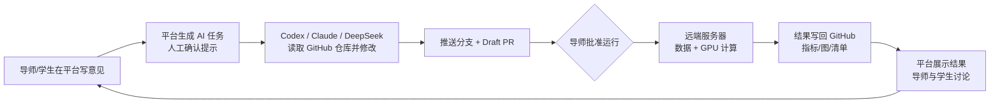
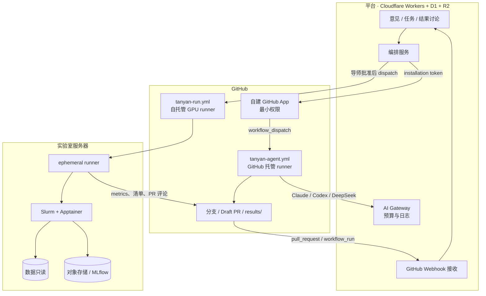

# AI 协作闭环：调研、评估与开发方案

日期：2026-11-03。使用地区：美国（Codex、Claude 官方服务可直接使用）。

## 1. 目标闭环

平台只做编排、记录与讨论；代码修改在 GitHub Actions 或代理云端完成，计算在实验室服务器完成。每一步都留痕，合并、运行和验收由人决定。

## 2. 调研结论

### 2.1 导师–学生与课题组协作

| 做法 | 代表 | 可借鉴点 |
|---|---|---|
| 论文全流程管理 | TUM Thesis Management（开源，生产在用） | 选题→开题→审阅反馈→答辩的阶段门，三类角色 |
| 证据与审计 | eLabFTW（开源 ELN） | RFC 3161 可信时间戳、带含义签名、不可篡改审计日志 |
| 任务↔代码关联 | OpenProject GitHub 集成 | PR 描述写 `OP#ID` 即关联，工作包上显示 PR 和 CI 状态 |
| 反馈落到代码 | GitHub Classroom Feedback PR | 每个学生仓库一个汇总 PR，导师逐行评论 |
| AI 先检查、人来批准 | Benchling AI Notebook Check | AI 先标出错误和缺失，见证与审阅仍由人完成 |
| 国内研究生管理 | 各校中期考核系统、周见面制度 | 学生提交→导师审核→学院复审；见面记录纳入考核 |

空白：导师–学生–AI 的反馈闭环目前没有成熟的开源项目。项目管理和 ELN 层已有成熟方案，AI 科研代理层项目多、迭代快，两者之间缺一个连接层。

指导研究显示，每周见面的博士生满意度最高（比利时 836 人调查）。监控式分析会造成表演化汇报和寒蝉效应，因此平台应关注节奏，不做学生排名。

### 2.2 AI 编码代理与 GitHub（2026-11 现状）

| 方式 | 触发与产出 | 第三方平台能否程序化调用 |
|---|---|---|
| Claude Code GitHub Action `anthropics/claude-code-action@v1` | `@claude` 评论，或 `prompt` 加任意事件/cron；推分支、开 PR | 能：用 `workflow_dispatch` / `repository_dispatch` 触发 |
| Claude 无头模式与 Agent SDK | `claude -p --bare --output-format json`，可设预算和工具白名单 | 能：在自己的 runner/容器里运行 |
| Claude Managed Agents（beta） | REST 创建 agent、environment、session，事件流交互；沙箱可自托管 | 能：外部应用直接下发任务的最直接路径 |
| Codex GitHub Action `openai/codex-action@v1` | 内部执行 `codex exec`；有 sandbox 档位和 allow-users 限制 | 能：用 dispatch 触发 |
| Codex 云任务与 `@codex` | PR 中 `@codex review` / `@codex fix …`，云任务完成后开 PR | 部分能：未找到程序化创建云任务的公开 API |
| Codex SDK `@openai/codex-sdk` | `startThread().run()`，底层驱动 CLI | 能：在自己的 runner 里运行 |
| GitHub Copilot 编码代理 | 把 issue 指派给 Copilot / Claude / Codex，代理开 draft PR | 部分能：第三方代理仍是 public preview，需要 Copilot 付费席位 |
| DeepSeek 等开源权重模型 | 提供 Anthropic/OpenAI 兼容接口，可驱动 Claude Code CLI、OpenCode、OpenHands | 能：建议在美国托管或自建 vLLM，不直接调用 api.deepseek.com |

其他要点：

- 统一模型入口：LiteLLM 或 Cloudflare AI Gateway。平台本身就在 Cloudflare 上，可以做按学生的预算、日志和换模型。
- GitHub Models 已于 2026-07-30 下线，不要考虑。
- 安全：2025 年底披露的 PromptPwnd 类攻击显示，把 issue 或 PR 原文直接拼进提示词，再配合高权限 token，可能泄露密钥。应对办法：
  - 代理只接收平台下发的已清洗任务文本；
  - CI 中使用 `--bare`，不加载仓库自带的 hooks 和 MCP 配置；
  - 代理所在的 job 不接触 secrets。

### 2.3 远端计算与结果回写

- 自托管 GitHub runner 只需要出站 443，不需要开放入站端口，适合放在校内网络后的 GPU 服务器上。使用 `--ephemeral` 或 JIT 配置可以做到一次 job 一台干净 runner。
- 有 Slurm 时，runner 放在常驻小节点上，用 `sbatch` 提交并轮询；不要放在登录节点。没有 Slurm 时，可用 dstack 或 SkyPilot 统一纳管服务器和云 GPU。
- 隔离：Apptainer（HPC 常用，不需要 root，`--nv` 暴露 GPU）或 rootless Podman 加 CDI。学生代码和 AI 生成的代码一律按不可信处理：数据只读挂载，出站网络受限。
- 实验跟踪：
  - 可选：MLflow（自托管，必须开认证，只在内网暴露）、DVC（数据版本，remote 可用 S3/MinIO）、ClearML。
  - 不建议：W&B 免费版禁止机构使用；Neptune 已停服；CML 自 2024-10 起无新版本。
- 回写分工：
  - 小文件（`metrics.json`、缩略图、清单）提交到 `results/<run-id>/`，并发 PR 评论和 Job Summary；
  - 大文件放对象存储，Git 里只存链接和 sha256；
  - Actions artifact 最多保留 90 天，不能用于长期归档；
  - 每次运行写一份 RO-Crate 清单（commit、数据哈希、镜像 digest、参数）。

### 2.4 学术规范

- AI 不能作为作者，只能作为工具披露（ICMJE、COPE）。代码可参照 Linux 内核的 `Assisted-by: 代理:模型版本` 规则：签署和审查必须由人完成。
- 学生若申请中国学位，2026-05 中国学位与研究生教育学会的指南要求学位论文附“人工智能使用声明”（工具、版本、用途、环节、核验方式），并做到“过程可追溯、结果可核验”。美国方面以所在学校和期刊政策为准。
- 部分美国州政府和机构限制使用 DeepSeek 官方应用和服务，接入前需确认学校政策。

## 3. 现有平台评估

### 3.1 已有基础（可直接复用）

| 闭环环节 | 已有模块 | 复用方式 |
|---|---|---|
| 导师意见 | `student_guidance_notes`：标题、内容、下一行动、期限、验收标准、验证方式、学生回报、导师核验 | 作为 AI 任务的来源，新增“交给 AI 执行”动作 |
| 进展与证据 | `progress_entries` / `progress_revisions` / `progress_evidence_sources`，SHA-256 指纹、修订号 CAS | AI 产出的 PR 和运行结果作为进展证据，进入原审核流程 |
| 审计 | `progress_audit_events`、各类 `*_events` 表，追加式 | 沿用同一模式记录 AI 调用和运行 |
| 仓库 | `student_repository_bindings`（仅元数据，已规划只读 GitHub App） | 扩展为 GitHub App 安装与仓库 ID 绑定 |
| 成果台账 | `research_outputs`，含软件、数据集 | 运行产出的模型和数据集登记为成果 |
| 外部桥接 | 飞书长连接 bridge：本机进程出站连接，用 HMAC 签名回传站点 | 同一模式用于“计算桥”：校内服务器只做出站连接 |
| 权限 | 超级管理员、导师、学生三级；分配范围；自审限制；幂等与并发保护 | AI 任务与运行沿用同一套授权 |
| 存储 | R2 附件、D1 | 派生图和小结果放 R2；原始数据不进入 R2 |

工程质量较好：327 项自动化测试，迁移、并发版本控制、幂等写入和审计纪律都很完整，适合继续扩展。

### 3.2 差距

1. 没有任何 LLM 调用。会议纪要拆分是纯规则实现；模型密钥和预算也没有管理。
2. 没有 GitHub API、GitHub App 或 webhook 接收，仓库绑定只是一个链接。
3. 没有“任务 / 运行 / 结果”数据模型，也没有结果讨论串。
4. Workers 不能运行代理或计算任务（CPU 时间和运行时限制），必须引入外部执行层（GitHub Actions、代理云或自托管 runner）。
5. 美国使用的登录方式：代码固定使用飞书中国域（`Lark.Domain.Feishu`）。需要决定改用 Lark 国际版，或增加 GitHub / Google / Microsoft SSO。
6. 维护性：
   - `app/dashboard.tsx` 有 3531 行，新增页面前应先拆分；
   - lint 有 4 个现存错误；
   - README 中“自动生成演示数据”的说明已过时；
   - 新的本地库需要手动执行迁移。

## 4. 目标架构

### 4.1 代理执行：统一工作流加三种提供方

在学生仓库放一个模板工作流 `.github/workflows/tanyan-agent.yml`，由平台用 `workflow_dispatch` 触发，输入为 `task_id`、`provider`、`task_text`（已清洗）、`base_ref`。

- `provider=claude`：`anthropics/claude-code-action@v1`，自动化模式。
- `provider=codex`：`openai/codex-action@v1`，`sandbox=workspace-write`。
- `provider=deepseek`：Claude Code CLI 或 OpenCode，`ANTHROPIC_BASE_URL` 指向网关，网关后接美国托管的 DeepSeek 权重。

三种方式的产出约定一致：

- 分支 `agent/<task_id>`，PR 为 Draft；
- PR 正文第一行 `Tanyan-Task: <task_id>`；
- 提交带 `Assisted-by: <provider>:<model>`；
- 不修改 `.github/` 和 `results/`。

代理 job 运行在 GitHub 托管 runner 上（改代码不需要 GPU，且天然隔离），不接触任何计算或数据密钥。

后续增强：交互式多轮修改可接 Claude Managed Agents API，平台直接持有会话；PR 审查可加 `@codex review` 或 Claude review 作为第二意见。

### 4.2 计算：导师批准后在校内执行

- PR 上出现平台下发的 `run-approved` 标签，或平台直接 dispatch 时，`tanyan-run.yml` 在 `gpu` runner group 上运行。
- runner 用 ephemeral 模式，job 内用 `sbatch` 提交 Apptainer 作业。镜像固定 digest，数据只读挂载，输出目录每次运行单独一个。
- 审批放在平台侧完成。GitHub Environments 的 required reviewers 对私有仓库需要 Enterprise 计划；如果学校通过 GitHub Education 获得 Enterprise，可以再加一层。
- 运行结束后执行固定的回写脚本：
  1. 写 `results/<run-id>/manifest.json`（RO-Crate 风格：commit、数据哈希、镜像 digest、参数、指标、文件 sha256）、`metrics.json` 和缩略图，提交到 PR 分支；
  2. 大文件上传对象存储，清单里只记链接和哈希；
  3. 发 PR 评论（指标表、与基线的差异）和 Job Summary。
- 平台通过 `workflow_run` webhook 得知运行完成，用 installation token 读取清单，写入 D1，并把缩略图存入 R2。

### 4.3 讨论与下一轮

- 结果页显示：指标与基线对比、图、代码 diff 链接、PR 与 CI 状态、AI 使用记录。
- 导师和学生在结果下讨论（评论串，可选同步到 PR）。导师可以：
  - 确认结果，作为进展证据进入原审核流程；
  - 一键把讨论转成新的导师意见，进入下一轮；
  - 合并 PR（在 GitHub 上由人操作）。

### 4.4 人工闸门

| 闸门 | 谁 | 内容 |
|---|---|---|
| G1 任务下发 | 导师，或学生加导师确认 | 确认任务文本、提供方、预算 |
| G2 代码合并 | 导师或学生（分支保护要求 1 人审查） | 审查 Draft PR |
| G3 计算运行 | 导师 | 批准占用 GPU 和数据 |
| G4 结果验收 | 导师 | 结果是否作为有效进展证据 |

### 4.5 安全与数据

- 自建 GitHub App 权限：Contents、Pull requests、Issues 读写；Actions 写（dispatch）；Checks 读；Metadata 读。按仓库安装，token 用一个签一个，1 小时过期。
- 模型密钥只放在 GitHub 组织 secrets 或网关中，平台按学生签发网关虚拟 key 并设月度预算。
- 代理只读平台下发的文本，不读取 issue 或评论原文；代理 job 与运行 job 分离；网络走白名单。
- 数据分级：
  - 受出口管制（ITAR/EAR）或合作方保密的射线数据不得发送给外部模型，也不得进入 R2；
  - 只允许派生指标和图离开服务器；
  - 必要时只用自托管模型处理这类数据。
- 自托管 runner 只服务私有仓库，按 runner group 限定仓库，机器当作随时可重建。

## 5. 新增数据模型（草案）

| 表 | 关键字段 |
|---|---|
| `github_installations` | installation_id、account、仓库范围、状态 |
| `student_repositories` 扩展 | repo_id、installation_id、default_branch（保留现有绑定和审计） |
| `agent_tasks` | id、student_id、source_guidance_id、task_text、provider、model、budget、status（draft→approved→dispatched→pr_open→merged/closed/failed）、created_by、approved_by |
| `agent_task_events` | 追加式：dispatch、webhook、状态变化、操作者 |
| `ai_usage_records` | task_id、provider、model、tokens、cost、prompt 摘要哈希、输出 PR/commit、采纳人；用于导出 AI 使用声明 |
| `compute_runs` | id、task_id/PR、commit、runner、slurm_job_id、image_digest、status、approved_by、开始/结束时间 |
| `run_results` | run_id、manifest sha256、metrics JSON、R2 缩略图键、外部大文件链接、baseline_run_id |
| `result_comments` | run_id、author、body、parent_id、转为意见的 guidance_id |

迁移沿用现有规范：只建表、加索引和约束；运行时校验完整结构后再升级 schema 版本。

## 6. 开发路线

假设 1–2 名开发者。每个阶段单独可用、单独发布。

| 阶段 | 周期 | 交付 | 验收 |
|---|---|---|---|
| P0 基础整理 | 1–2 周 | 修复 lint；增加 `db:migrate:local` 和本地测试账号脚本；更新 README；拆分 `dashboard.tsx`；确定美国登录方式（Lark 国际版或 GitHub/Google SSO） | 新人能按 README 10 分钟内跑起本地环境；测试全部通过 |
| P1 GitHub 连接 | 2–3 周 | 自建 GitHub App；安装与仓库绑定；webhook 验签入口；学生页显示近期 commit 和 PR；PR 可作为进展证据 | 合成仓库上完成安装、事件接收、PR 关联；无权仓库被拒绝 |
| P2 AI 任务 | 3–4 周 | 从导师意见创建 AI 任务；G1 确认；`tanyan-agent.yml` 模板；Claude、Codex、DeepSeek 三种提供方；状态跟踪；AI 使用记录与预算 | 同一意见分别由三种提供方生成 Draft PR，平台状态与 GitHub 一致；超预算被拒绝 |
| P3 计算与结果 | 3–4 周 | 一台 GPU 服务器部署 ephemeral runner、Slurm、Apptainer；G3 审批；回写脚本与清单规范；结果入库与结果页 | 一个真实小实验从批准到结果显示全链路跑通；清单哈希可校验 |
| P4 讨论闭环 | 2–3 周 | 结果评论串；讨论转新意见；G4 验收进入原审核流程；AI 使用声明导出；可选的飞书摘要推送 | 完成两轮“意见→PR→运行→讨论→新意见” |
| P5 增强 | 持续 | Claude Managed Agents 交互会话；双代理交叉审查；多次运行对比；RO-Crate 导出；MLflow/DVC 链接 | 按需求逐项验收 |

建议先用 1 名学生的 1 个仓库试点 P1–P4，再扩大范围。

## 7. 需要尽快确定的事项

1. 登录：继续用飞书（中国域或 Lark 国际版），还是改为 GitHub / 学校 SSO。
2. GitHub 组织与计划：Team 还是 Enterprise（是否能通过 GitHub Education 获得）；这决定能否使用 Environments 审批。
3. 模型计费：组织级 API key 加平台预算，还是使用 ChatGPT / Claude 团队订阅（订阅 OAuth token 能否用于自动化需按条款确认）。
4. 计算位置：实验室服务器（是否已有 Slurm），还是云 GPU（SkyPilot / dstack）。
5. 数据分级：哪些数据受出口管制或合作方协议约束，决定哪些任务只能用自托管模型。

## 8. 风险

| 风险 | 缓解 |
|---|---|
| 代理被仓库内容提示注入、泄露密钥 | 只下发清洗后的任务文本；`--bare`；代理 job 不放密钥；最小权限 App |
| 学生或 AI 代码破坏共享 GPU 服务器 | ephemeral runner；Apptainer；资源配额；导师批准后才运行 |
| 费用失控 | 网关按学生设预算；任务级 `--max-budget-usd`；月度报表 |
| 平台变成监控工具 | 只看节奏与待办，不做排名；会话级摘要，不保存逐字稿 |
| 学术诚信 | `Assisted-by` 标注；AI 使用记录可导出；核心创新由本人声明 |
| 供应商接口变动（beta 功能） | 提供方适配层；首选稳定的 GitHub Action 路线，Managed Agents 作为增强 |

## 9. 主要来源

- Claude Code GitHub Actions：https://code.claude.com/docs/en/github-actions
- Claude 无头模式：https://code.claude.com/docs/en/headless
- Claude Managed Agents：https://platform.claude.com/docs/en/managed-agents/quickstart
- Codex GitHub 集成：https://developers.openai.com/codex/integrations/github
- Codex GitHub Action：https://learn.chatgpt.com/docs/github-action.md
- Codex SDK：https://developers.openai.com/codex/sdk
- GitHub 第三方编码代理：https://docs.github.com/en/copilot/concepts/agents/about-third-party-coding-agents
- GitHub Models 下线：https://github.blog/changelog/2026-07-30-github-models-is-now-retired/
- 自托管 runner 通信：https://docs.github.com/en/actions/concepts/runners/communicating-with-self-hosted-runners
- Environments 审批：https://docs.github.com/en/actions/reference/workflows-and-actions/deployments-and-environments
- DeepSeek Anthropic 兼容接口：https://api-docs.deepseek.com/guides/anthropic_api
- LiteLLM Codex 接入：https://docs.litellm.ai/docs/harness/codex
- Cloudflare AI Gateway：https://developers.cloudflare.com/ai-gateway/features/unified-billing/
- dstack fleets：https://dstack.ai/docs/concepts/fleets/
- Apptainer GPU：https://cvw.cac.cornell.edu/vista/user-environment/apptainer
- Workflow Run RO-Crate：https://www.ncbi.nlm.nih.gov/pmc/articles/PMC11386446/
- TUM Thesis Management：https://docs.thesis.aet.cit.tum.de/about
- eLabFTW 可追溯性：https://doc.elabftw.net/docs/usage/traceability-and-auditability
- OpenProject GitHub 集成：https://www.openproject.org/blog/how-to-openproject-github-integration/
- GitHub Classroom Feedback PR：https://docs.github.com/en/education/manage-coursework-with-github-classroom/teach-with-github-classroom/leave-feedback-with-pull-requests
- 博士指导频率调查：https://www.en.phddata.frs-fnrs.be/supervisors/supervision-during-phd
- Linux 内核 AI 编码助手规则：https://docs.kernel.org/next/process/coding-assistants.html
- 研究生学位论文 AI 使用指南（2026-05）：https://m.gmw.cn/2026-05/16/content_38768407.htm

未核实：Codex 云任务的程序化 API；第三方代理在 Copilot 指派中的 API 支持范围；GitHub 自托管 runner 收费的最终方案；订阅 OAuth token 用于组织自动化的条款边界。
