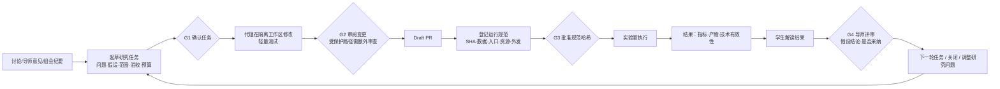

# 科研闭环前端优化方案

日期：2026-11-03。依据：
- 设计包 `research_collaboration_design_pack_20261103/`：01 报告第三至第十节、02 契约第 3、6、10 节、05 验收矩阵、`templates/research_task.example.yaml`；
- 当前实现：`components/research-loop/**`、`app/students/[id]/student-overview.tsx`、`app/dashboard.tsx`，以及 `outputs/research-loop-ui/` 中的截图。

## 结论

1. 现有界面已经覆盖设计包要求的四种卡片（任务、变更、运行、结果评审），权限也都以服务端返回的 `permissions` 为准。主要问题在**组织方式**：
   - 界面按“对象类型”组织，每个任务下面依次堆着代理尝试、变更请求、运行与结果；
   - 设计包要求的是“以研究任务为主线、以人的决定为节点”；
   - 结果是用户要滚动、拼凑，才能知道这个任务卡在哪一步、轮到谁处理。
2. 导师的四类决定（确认任务、额外审查、批准运行、评审结果）现在**只能在每个学生的档案里找到**，没有进入已有的“待我处理”收件箱。人数一多，决定就会堆积。
3. 设计包要求的三个科研要素还没有界面，需要配合少量后端改动：
   - 结果卡的**基线对比**（现在显示“未登记”）；
   - **学生对结果的解读**（现在只有自由评论）；
   - 从闭环生成**进展证据**（闭环和现有的进展、月度确认体系没有打通）。
4. 可追溯信息（哈希、SHA、清单）应当完整保留，但现在占据了主视野。应改为渐进披露：先给人看懂的摘要，需要核对时再展开哈希。

## 一、工作流分析

### 1.1 一条研究任务的完整路径（设计包 01 第四节、02 第 6 节）

### 1.2 角色与职责（设计包 01 第九、十节）

| 角色 | 在闭环中负责 | 不应承担 |
|---|---|---|
| 导师 | 研究问题、关键方案、资源投入（G3）、结论（G4） | 逐行审查每个 AI 生成的 PR |
| 学生 | 提出假设、理解修改、解释结果；起草和确认自己的任务 | 把“AI 跑完了”当作已经理解实验 |
| 高年级学生 / 研发人员 | 常规代码审查（G2） | 批准资源和结论 |
| 超级管理员 | 仓库关联、执行器、入口、数据授权、凭据档案 | 代替导师做科研判断 |
| AI 代理 | 在确认的范围内修改、测试、整理 | 决定研究方向；自报的指标不能作数 |

### 1.3 每个决定节点需要看到什么

| 节点 | 决定人 | 做决定必须看到的信息 | 不应干扰决定的信息 |
|---|---|---|---|
| G1 确认任务 | 学生本人或导师 | 本版和上一版的差异、修改范围、受保护路径、预算、来源意见 | 快照哈希（可折叠） |
| G2 审阅变更 | 审查人（导师 / 指定同伴） | 改了哪些文件、哪些触及受保护路径或越界、代理自述的计划与实际执行的测试、diff | 代理的逐条事件流 |
| G3 批准运行 | 导师 | 跑哪一版代码（来自哪个 PR）、用哪个数据版本、占用什么资源、什么会离开实验室、与任务预算的关系 | 完整哈希（可展开核对，批准时绑定） |
| G4 评审结果 | 导师 | 技术有效性、和基线的对比、评价协议是否一致、学生的解读、失败与例外 | 产物的完整 sha256 |

## 二、现状对照

| 工作流环节 | 现状 | 差距 |
|---|---|---|
| 讨论 → 任务 | 导师意见可“转为研究任务”，预填内容并记录来源 | 组会纪要、进展条目不能引用为任务；任务卡只写“来自导师意见”，没有链接到原意见 |
| 任务确认 G1 | 有版本选择、确认按钮和重新确认提示 | 看不到两个版本之间改了什么；确认时看不到修改范围对应哪些目录 |
| 代理执行 | 状态、事件每 4 秒轮询（`attempt-card.tsx`） | 事件流是原始状态码（如“状态 started #1”），手机上非常长；没有“代理做了什么”的一段话总结 |
| 变更审阅 G2 | 文件列表、diff 统计、受保护路径警告、额外审查、发布 | 越界和受保护的文件没有逐个标出；看不到代理实际跑过的测试；分支名不易读（如 `tanyan/0ab5feb0/lished01`） |
| 运行登记 | 表单可选变更请求、入口、参数、数据集、资源 | 不显示剩余预算；外发策略只有技术描述 |
| 批准 G3 | 规范摘要加完整哈希，批准时绑定哈希 | 哈希和长 SHA 占据首屏（截图 02）；“批准了什么”需要读技术字段才能理解 |
| 结果 | 技术有效性、假设结论、导师评审分开显示；指标附来源；产物标明外发去向 | 没有基线对比；评价协议是否一致没有直接提示；运行编号取 ID 后 8 位（如“运行 aiting01”） |
| 学生解读 | 只有自由评论 | 设计包要求学生先解释正面和负面结果，再由导师评审 |
| 评审 G4 → 下一轮 | 评审表单；“转为下一轮任务”；来源运行有记录 | 下一轮任务只显示 ID；看不到完整谱系（意见 → 任务 → PR → 运行 → 评审 → 新任务） |
| 导师视角 | 只能逐个学生查看 | “待我处理”（`app/api/dashboard/route.ts` 中的 `workflowTasks`）没有闭环决定；全组进度没有闭环信号 |
| 与进展体系 | 两套体系各自独立 | 结果不能一键成为进展证据；周会缺少证据清单（设计包 01 第九节） |
| 准备度 | 缺条件时各处单独提示（例如没有凭据档案） | 没有统一的“闭环准备度”，看不出由谁去补齐哪一项 |
| 命名 | 档案页同时有“任务与结果”和“科研闭环”两个标签 | “任务”一词有两个含义，容易混淆 |

## 三、设计原则（从设计包提炼）

1. **以研究任务为主线**：任务是唯一入口，代码、运行和结果都挂在任务下，按阶段展开。
2. **以决定为中心**：每个界面先回答“现在轮到谁、要决定什么”，再给出证据。
3. **三种状态分开**：代理产出成功、实验技术有效、研究结论被接受，任何时候都分开显示，绝不合并成一个“成功”。
4. **证据先于结论**：指标必须显示来源文件；AI 的自然语言不作为指标；失败的运行保留在原位。
5. **可追溯但不打扰**：哈希、SHA、清单都保留，默认折叠，展开后可复制核对。
6. **不监控、不排名**：不显示提交次数、AI 生成字数、在线时长等指标；全组视图只显示待处理事项和卡点。
7. **授权以服务端为准**：前端只根据 `permissions` 显示或隐藏操作，并说明为什么不能做。

## 四、优化方案

按依赖程度分三级：**F** 只改前端；**FA** 需要少量后端字段或接口；**FB** 需要新的后端能力或角色。

### F1 任务阶段条与“下一步”（F）

- 每张任务卡标题下加 5 段阶段条：任务 → 代码 → 运行 → 结果 → 下一轮。每段显示状态和负责人，例如“代码：变更待额外审查 · 导师”。
- 卡片头部显示一句“下一步”，例如“等待导师批准运行 #3”“学生需要确认第 2 版”。规则只由已有字段推导（任务状态、attempt 状态、变更请求状态、run 状态、review 状态），不依赖新接口。
- 展开后默认定位到当前阶段，已完成的阶段折叠为一行摘要。
- 涉及文件：`task-card.tsx`，新增 `stage-model.ts`（纯函数，配单元测试）。
- 验收：在合成数据的各个状态下，“下一步”文案和负责人都正确；纯函数测试覆盖全部状态组合。

### F2 决策卡的信息层次（F）

- **G1**：版本之间的差异视图，逐字段比较两个 `TaskVersion`，在前端完成。
- **G2**：
  - 文件列表逐行标注“受保护”“超出范围”（用 `contracts.ts` 的 `evaluatePathPolicy` 在前端复算，只用于展示）；
  - 单独显示代理实际执行的测试命令和退出码（`tests_json` 已经在接口里返回）；
  - diff 按文件折叠；
  - 分支名旁边显示 PR 编号和链接。
- **G3**：在哈希之前先给一段人能读懂的“批准内容”，例如：
  > 用 PR #12 的代码（e4a0801）在“合成数据 v1”上训练 30 轮，1 块 GPU，最长 2 小时；只有 .json/.csv/.log 会离开实验室，图片和模型留在实验室。

  完整哈希、执行 SHA、镜像摘要放进“可追溯信息”折叠区，提供复制按钮。批准按钮仍然绑定 `runSpecSha256`。
- **G4**：评审表单上方固定显示“技术有效性 + 基线对比（FA2）+ 学生解读（FA3）”，让评审基于证据。
- 涉及文件：`change-request-card.tsx`、`run-card.tsx`、`task-card.tsx`，新增 `spec-summary.ts`。

### F3 可读的编号与谱系（F）

- 运行按任务内的顺序编号显示为“运行 #3（第 2 次尝试）”，ID 放进折叠区。代理尝试同理，显示为“代理 #2 · Codex”。
- 任务卡显示来源链接：“来自导师意见《…》（日期）”，可跳转到指导标签对应的意见；“来自运行 #3 的评审”，可跳转到对应结果卡。
- 结果卡底部显示谱系：原意见 → 任务第 N 版 → PR #x → 运行 #y → 评审 → 下一轮任务（链接）。这是 T25 可追溯性的可视化。
- 涉及文件：`task-card.tsx`、`run-card.tsx`；数据都在现有接口里（`sourceGuidanceNoteId`、`sourceRunId`、`parentTaskId`、`followupTaskId`、`changeRequestId`）。

### F4 代理过程的压缩展示（F）

- 事件流改成时间线：只显示阶段性事件（领取、工作区就绪、开始、测试、产出、结束），消息和工具调用折叠为“共 N 条，展开”。
- 用一段话总结：取代理最后一条消息事件作为“代理自述”，并标注“仅供参考，不作为指标”。
- 轮询只针对运行中的 attempt；页面隐藏时暂停（`document.visibilityState`），并逐步拉长间隔。
- 涉及文件：`attempt-card.tsx`。

### F5 运行状态实时化与失败展示（F）

- `dispatching`、`running`、`collecting`、`reconciling` 状态的运行卡片同样轮询，规则与 F4 一致。
- `reconciling` 显示为“正在与实验室核对作业状态（不会重复提交）”，消除误会。
- 失败卡片置顶显示失败原因（例如“作业退出码 1：显存不足”）以及下一步：“按同一规范重跑（需重新批准）”或“修改任务”。

### F6 闭环准备度清单（F）

- 在学生的闭环面板顶部，用清单展示：仓库已关联、发起人有代理凭据档案、至少一个已授权数据集、登记了运行入口、GitHub App 已配置。每项标明负责人（大多是超级管理员）和入口。
- 数据来自已有接口：`/api/research-tasks?taskId=` 的 `permissions.providers`，`/api/runs?studentId=` 的 `options`，以及 attempt 和 run 的错误码（`REPOSITORY_NOT_LINKED`、`CREDENTIAL_PROFILE_MISSING`、`GITHUB_NOT_CONFIGURED`）。
- 条件全部满足后，清单折叠为一行“闭环条件已就绪”。

### F7 命名与入口整理（F）

- 档案页命名（2026-11-03 已决定）：
  - 原“任务与结果”保留原名。它承载 `ProgressResolutionPanel`（进展中问题与下一步的跟进），页头“已完成任务”按钮也指向这里，改名会让这两处入口和既有习惯脱节。
  - 只把新加的“科研闭环”标签改为“代码与实验”，与“任务与结果”在字面上区分开；标签内的对象仍叫“研究任务”。设置页的“科研闭环配置”同步改为“代码与实验配置”。
  - URL 哈希 `#research-loop` 保持不变，旧链接继续可用；`#research-task-<id>`、`#research-run-<id>`、`#research-cr-<id>`、`#research-attempt-<id>` 都会切到“代码与实验”标签（卡片的展开与定位由面板内导航负责），`#guidance-<id>` 切到“指导记录”并展开该条。
- 学生端“研究”视图中，闭环面板放在仓库卡片下方，作为“研究”的主体，不用再找第二个入口。
- 移动端：长哈希一律截断并配复制按钮；表格改为卡片列表（W7 已保证不出现横向溢出，这里再提升可读性）。

### FA1 导师决定收件箱（FA）

- 在 `app/api/dashboard/route.ts` 的 `workflowTasks` 中新增四种类型：`task_confirmation`、`change_extra_review`、`run_approval`、`result_review`。只纳入当前用户 `canReviewStudent` 范围内的学生，并排除自己创建、因此不能自批的运行。
- 前端在“待我处理”中按“需要我决定”分组，每项直接打开对应的学生档案、任务和卡片（锚点）。
- 全组进度表增加“闭环待处理 N”一列。只计待处理事项，不计任何活跃度。
- 验收：导师 A 看不到范围外学生的事项；自建运行不出现在自己的批准队列；处理后立即从队列中消失。

### FA2 基线与评价协议对比（FA）

- 后端：在运行上增加可选的 `baseline_run_id`（同一学生、同一评价协议哈希、已完成且技术有效），并在详情接口返回基线的指标。不改变 RunSpec 和批准哈希的定义，基线只是比较对象。
- 前端：
  - 登记运行时可选择基线；
  - 结果卡显示“指标 / 本次 / 基线 / 差值”；
  - 评价协议哈希不一致时，显示醒目提示“评价协议不同，不能作为同协议对比”（T21）；
  - 基线缺失时如实显示“未设基线”。
- 不预设“必须比基线高”：差值只做展示，不着色成“好”或“坏”。

### FA3 学生解读（FA）

- 后端：新增结果解读记录，包括本次结果说明了什么、其他可能的解释、限制与异常、建议的下一步；支持版本，作者限学生本人。
- 前端：结果卡在导师评审之前显示“学生解读”区。学生提交解读后，导师的评审表单才显示“已有学生解读”；没有解读时允许评审，但要提示。
- 这一步对应设计包的要求：“学生负责提出假设、理解修改、解释结果”。

### FA4 从闭环生成进展证据（FA）

- 结果卡新增“生成进展草稿”：预填进展表单，证据来源附上 PR 链接、运行编号、执行 SHA、metrics 来源文件和 sha256，摘要来自学生解读（FA3）。走现有的进展提交与导师审核流程，月度统计规则不变。
- 学生首页的“下一步”显示“运行 #3 已有结果，可以写进展”。
- 周会证据清单：在学生的“进展”视图生成本周期的证据列表（推进了哪些任务、产生了哪些 PR、跑了哪些运行、遇到哪些阻塞），由学生补充“为什么这样做、意味着什么、下一步如何判断”。对应设计包第九节。

### FB1 同伴代码审查角色（FB）

- 设计包建议由高年级学生或研发人员承担常规 G2 审查，避免所有 PR 都卡在导师手里。这需要在后端新增“审查委托”（由导师指定、限定学生范围、只能做 G2）。
- 前端在变更请求卡显示审查人，并区分“同伴已审查”和“导师额外审查”。受保护路径的额外审查仍然只能由导师完成。

### FB2 先出计划、再修改（FB）

- 设计包流程中有“AI 提出修改计划 → 批准有限范围修改”。状态机里已经有 `waiting_approval`，但代理工作进程尚未实现“只出计划”模式。
- 实现后，前端在代理卡片上显示计划和“同意按此计划修改 / 退回”，并用于高风险任务（例如触及受保护路径的任务）。

### FB3 状态变化通知（FB）

- 通过现有的飞书机器人，在轮到某人决定时推送一条摘要（不含代码和数据）。链接直接打开对应卡片。

## 五、不做的事

沿用设计包的边界：
- 不做在线 IDE、全自动写论文、多代理辩论；
- 不做学生排名、活跃度评分、提交次数统计；
- 不在前端展示原始数据样本，图片类产物默认留在实验室；
- 不在前端重新推导授权。

## 六、实施顺序与验收

| 批次 | 内容 | 依赖 | 验收 |
|---|---|---|---|
| 1 | F1、F3、F7 | 无 | 合成数据下每个状态的“下一步”和负责人都正确；谱系链接可从意见一路跳到下一轮任务（T25 可视化）；改名后档案页不再出现两个“任务”标签 |
| 2 | F2、F4、F5、F6 | 无 | 导师在不展开“可追溯信息”的情况下，能用一句话说出“批准了什么”；手机上一个代理卡片不超过一屏；`reconciling` 有说明；缺失条件都能指向负责人 |
| 3 | FA1 | 一个接口扩展 | 导师从“待我处理”能直接完成 G1–G4；范围隔离、自批排除有测试 |
| 4 | FA2、FA3、FA4 | 迁移 + 接口 | 基线对比和协议不一致提示（T21）；学生解读在评审前可见；进展草稿带完整证据链接 |
| 5 | FB1–FB3 | 新角色、工作进程模式、通知 | 按设计包试点指标观察：意见到 PR 的时延、人工审查时长、导师找到原始证据所需时间 |

每一批都要做到：
- `npm run typecheck`、`npm run lint`、`npm test` 全部通过；
- 用合成数据在浏览器里检查导师、学生、超级管理员三种视角，桌面宽度和 390px 都要看；
- 控制台没有新的错误。

试点阶段，可以在超级管理员的视图里观察设计包建议的流程指标（闭环完成比例、意见到 PR 的时延、审查时长、复现成功率）。这些指标只用于评估流程本身，不作为评价学生的依据。
